# Employee Payroll Information System (Sistem Penggajian Karyawan)

**A local-first Windows Forms desktop payroll and attendance tracking system with polymorphic salary calculations and webcam-based QR Code kiosk check-in.**

[](https://www.microsoft.com/windows)
[](https://dotnet.microsoft.com/en-us/download/dotnet-framework/net48)
[](https://learn.microsoft.com/en-us/dotnet/csharp/)
[](https://www.mysql.com/)
[](https://www.nuget.org/packages/AForge.Video.DirectShow/)
[](https://www.nuget.org/packages/ZXing.Net/)
[](https://www.nuget.org/packages/BouncyCastle.Cryptography/)
[](LICENSE)

---

## Table of Contents

- [Overview](#overview)
- [Practical Use Cases](#practical-use-cases)
- [Core Engineering Capabilities](#core-engineering-capabilities)
- [System Architecture](#system-architecture)
- [Repository Structure](#repository-structure)
- [Operational Runbook](#operational-runbook)
  - [Hardware & Environment Requirements](#hardware--environment-requirements)
  - [Default Credentials](#default-credentials)
  - [Database Configuration](#database-configuration)
  - [Kiosk Mode Operation](#kiosk-mode-operation)
- [Local Development & Build](#local-development--build)
- [Coding Conventions](#coding-conventions)
- [Academic Attribution & Team](#academic-attribution--team)
- [License](#license)

---

## Overview

**Sistem Informasi Penggajian Karyawan** is an on-premise Windows Forms desktop application built in C# targeting .NET Framework 4.8. Developed as an Object-Oriented Programming (OOP) laboratory project at Politeknik Negeri Cilacap, the system consolidates employee master data management, daily attendance logging, shift tolerance enforcement, dynamic salary component configuration, monthly payroll generation, and payslip printing into a single operational interface.

The application operates locally against a MySQL database without external cloud services or telemetry. An automated seeder class ([DatabaseSeeder.cs](SistemPenggajianKaryawan/Konfigurasi/DatabaseSeeder.cs)) executes on application startup to verify the schema, apply necessary table mutations, and initialize baseline configurations and test accounts.

---

## Practical Use Cases

- **Reception & Gate Kiosk**: Deployed on a dedicated terminal screen using a connected USB webcam. Employees present their physical QR badge to clock in or clock out. Replaces paper sign-in sheets and reduces manual attendance entry delays.
- **HR & Payroll Processing**: HR administrators configure shift schedules, grace periods, allowances, and deductions. At the end of each period, monthly payroll calculations execute automatically across all active employee classifications.
- **System Administration & Security**: Administrators provision user accounts, map accounts to employee records, handle password resets, and export high-resolution QR identity badges as PNG files.
- **Employee Self-Service**: Individual workers log in to view attendance summaries, verify work day statuses, and view or print formatted payslips directly via the Windows Print Spooler.

---

## Core Engineering Capabilities

- **Polymorphic Payroll Computation**: Implements an OOP class hierarchy rooted in the abstract [BaseKaryawan.cs](SistemPenggajianKaryawan/Model/BaseKaryawan.cs) class. Concrete implementations ([KaryawanTetap.cs](SistemPenggajianKaryawan/Model/KaryawanTetap.cs), [KaryawanKontrak.cs](SistemPenggajianKaryawan/Model/KaryawanKontrak.cs), and [KaryawanHarian.cs](SistemPenggajianKaryawan/Model/KaryawanHarian.cs)) override the calculation routine to enforce specific pay structures, attendance factors, and component eligibilities.
- **Dynamic Compensation Engine**: Allowances (`Tambah`) and deductions (`Potong`) can be defined as flat nominal values or percentage-based multipliers with designated employment scopes (`Semua`, `Tetap`, `Kontrak`, `Harian`) via [KomponenGaji_serv.cs](SistemPenggajianKaryawan/Service/KomponenGaji_serv.cs).
- **Webcam Video Capture & QR Decoding**: Integrates `AForge.Video.DirectShow` to enumerate and stream frames from local video input devices, coupled with `ZXing.Net` barcode readers to decode employee QR codes continuously without third-party services.
- **Shift & Grace Period Enforcement**: Configures standard check-in hours (`jam_masuk_normal`), departure times (`jam_keluar_normal`), and late tolerances (`toleransi_menit`). The system flags tardiness and feeds attendance records directly into payroll deduction formulas.
- **Symmetric Password Encryption**: User passwords stored in the database are encrypted using AES-256 via [Auth_serv.cs](SistemPenggajianKaryawan/Service/Auth_serv.cs), preventing plaintext exposure in storage.
- **Direct GDI+ Payslip Printing**: Uses .NET GDI+ print routines in [FormSlipGaji.cs](SistemPenggajianKaryawan/FormSlipGaji.cs) to render dynamic payslips onto bitmap graphics canvases and route them to physical or virtual PDF printers.
- **Kiosk Terminal Lockout**: When authenticated under the `Kiosk` role, the window locks into an attendance scanner display. Exiting requires supervisor override verification via [FormAuthExit.cs](SistemPenggajianKaryawan/FormAuthExit.cs).
- **Self-Healing Database Seeder**: Automatically creates missing tables, updates column lengths and enumerations, migrates legacy employee codes (`PNC.2026.XXXX`), and seeds default accounts and sample May 2026 attendance records on initial boot.

---

## System Architecture

```mermaid
flowchart TD
    subgraph UI["Presentation Layer (Windows Forms)"]
        F_Splash["FormSplash\n(Boot & Seeder)"]
        F_Login["FormLogin\n(Authentication Gateway)"]
        F_Admin["FormDashboardAdmin\nFormKaryawan\nFormManajemenUser\nFormQRPreview"]
        F_HRD["FormDashboardHRD\nFormKomponenGaji\nFormProsesGaji\nFormRekapAbsensi\nFormRekapGaji"]
        F_Emp["FormDashboardKaryawan\nFormSlipGaji\nFormGantiPassword"]
        F_Kiosk["Kiosk Scanner\n(FormAbsensi & FormAuthExit)"]
    end

    subgraph Hardware["Hardware & I/O Integrations"]
        Cam["USB / Integrated Webcam\n(AForge.Video.DirectShow)"]
        QRReader["QR Decoding Engine\n(ZXing.Net)"]
        GDIPrinter["Windows Print Spooler\n(GDI+ Canvas)"]
    end

    subgraph Service["Service & Business Logic Layer"]
        AuthServ["Auth_serv\n(AES-256 Encryption & Auth)"]
        UserServ["User_serv\n(User Account CRUD)"]
        KaryawanServ["Karyawan_serv\n(Employee Master CRUD)"]
        AbsensiServ["Absensi_serv\n(Attendance & Shifts)"]
        KomponenServ["KomponenGaji_serv\n(Allowances & Deductions)"]
        GajiServ["Gaji_serv\n(Payroll Engine & Factory)"]
        Session["UserSession\n(Static Role & Context)"]
    end

    subgraph Domain["Domain Model Layer (OOP)"]
        BaseKaryawan["BaseKaryawan (Abstract)"]
        KTetap["KaryawanTetap"]
        KKontrak["KaryawanKontrak"]
        KHarian["KaryawanHarian"]
        M_Absensi["DataAbsensi"]
        M_Komponen["KomponenGaji"]
        M_Config["KonfigurasiAbsensi"]
    end

    subgraph DataAccess["Data Access & Persistence"]
        Koneksi["Koneksi\n(ADO.NET MySqlConnection Wrapper)"]
        Seeder["DatabaseSeeder\n(Schema Auto-Init & Migration)"]
    end

    subgraph Storage["Database (MySQL)"]
        DB_Users[("users")]
        DB_Karyawan[("karyawan")]
        DB_Absensi[("absensi")]
        DB_Config[("konfigurasi_absensi")]
        DB_Komponen[("komponen_gaji")]
        DB_Penggajian[("penggajian")]
    end

    %% Flow Connections
    F_Splash --> Seeder
    F_Login --> AuthServ --> Session
    Cam --> QRReader --> F_Kiosk
    F_Emp --> GDIPrinter

    F_Admin --> UserServ & KaryawanServ
    F_HRD --> AbsensiServ & KomponenServ & GajiServ
    F_Emp --> AbsensiServ & GajiServ
    F_Kiosk --> AbsensiServ

    GajiServ --> BaseKaryawan
    BaseKaryawan --> KTetap & KKontrak & KHarian
    GajiServ --> M_Absensi & M_Komponen & M_Config

    AuthServ & UserServ & KaryawanServ & AbsensiServ & KomponenServ & GajiServ --> Koneksi
    Seeder --> Koneksi
    Koneksi --> DB_Users & DB_Karyawan & DB_Absensi & DB_Config & DB_Komponen & DB_Penggajian
```



---

## Repository Structure

```text
SistemPenggajianKaryawan/
├── .gitattributes                          # Git attributes configuration
├── .gitignore                              # Git exclusion rules for .NET / Visual Studio
├── LICENSE                                 # MIT License
├── README.md                               # Project documentation
├── SistemPenggajianKaryawan.slnx           # Visual Studio XML Solution File
├── packages/                               # Cached NuGet dependencies
└── SistemPenggajianKaryawan/               # Primary Application Project
    ├── App.config                          # Application assembly configuration
    ├── packages.config                     # NuGet dependency manifest
    ├── Program.cs                          # Application bootstrapper
    ├── SistemPenggajianKaryawan.csproj     # MSBuild project definition
    ├── Konfigurasi/                        # Infrastructure, persistence, and session
    │   ├── DatabaseSeeder.cs               # Schema initializer, migrations, and seed data
    │   ├── Koneksi.cs                      # ADO.NET MySQL connection execution wrapper
    │   ├── Konfigurasi.cs                  # Abstract database query base class
    │   └── UserSession.cs                  # In-memory authenticated session state
    ├── Model/                              # Object-Oriented domain models
    │   ├── BaseKaryawan.cs                 # Abstract base class defining HitungGaji contract
    │   ├── KaryawanTetap.cs                # Permanent employee model implementation
    │   ├── KaryawanKontrak.cs              # Contract employee model implementation
    │   ├── KaryawanHarian.cs               # Daily worker model implementation
    │   ├── KomponenGaji.cs                 # Salary component model (Nominal / Percentage)
    │   ├── DataAbsensi.cs                  # Attendance log entity
    │   └── KonfigurasiAbsensi.cs           # Shift and tolerance parameters entity
    ├── Service/                            # Business logic and database operations
    │   ├── Absensi_serv.cs                 # Attendance management and shift settings
    │   ├── Auth_serv.cs                    # AES-256 encryption and credential validation
    │   ├── Gaji_serv.cs                    # Payroll calculation engine and employee factory
    │   ├── Karyawan_serv.cs                # Employee CRUD service
    │   ├── KomponenGaji_serv.cs            # Allowance and deduction management service
    │   └── User_serv.cs                    # User account management service
    ├── Resources/                          # Static image and branding assets
    │   └── Politeknik_Negeri_Cilacap.png   # Campus academic logo
    ├── Properties/                         # Assembly metadata and settings
    │   ├── AssemblyInfo.cs
    │   ├── Resources.Designer.cs
    │   └── Settings.Designer.cs
    ├── FormSplash.cs                       # Startup screen running database seeder
    ├── FormLogin.cs                        # Authentication screen with role routing
    ├── FormAuthExit.cs                     # Security override dialog to close Kiosk mode
    ├── FormGantiPassword.cs                # Password update utility
    ├── FormDashboardAdmin.cs               # Administrator workspace panel
    ├── FormDashboardHRD.cs                 # HRD operations panel
    ├── FormDashboardKaryawan.cs            # Employee self-service dashboard
    ├── FormKaryawan.cs                     # Employee master management form
    ├── FormManajemenUser.cs                # User account administration form
    ├── FormAbsensi.cs                      # Attendance editor and webcam kiosk scanner
    ├── FormKomponenGaji.cs                 # Allowance and deduction configuration form
    ├── FormProsesGaji.cs                   # Monthly payroll batch calculation form
    ├── FormRekapAbsensi.cs                 # Attendance log summary viewer
    ├── FormRekapGaji.cs                    # Historical payroll payouts viewer
    ├── FormQRPreview.cs                    # QR badge generator and PNG exporter
    └── FormSlipGaji.cs                     # Dynamic GDI+ payslip print preview
```

---

## Operational Runbook

### Hardware & Environment Requirements

| Requirement | Specification |
|---|---|
| **Operating System** | Windows 10 or Windows 11 (64-bit recommended) |
| **Target Runtime** | .NET Framework 4.8 Runtime |
| **Database Server** | MySQL Server 5.7+ / 8.0+ or MariaDB 10.3+ (e.g. via XAMPP, Laragon, or standalone) |
| **Camera (Kiosk Mode)** | USB webcam or integrated webcam supporting DirectShow capture |
| **Display Resolution** | 1024 x 768 minimum (1920 x 1080 recommended for Kiosk Mode) |

### Default Credentials

The auto-seeder provisions the following default accounts upon first boot:

| Role | Username | Password | Operational Scope |
|---|---|---|---|
| **Administrator** | `admin` | `admin123` | Employee master data, user accounts, and QR card downloads |
| **HRD** | `hrd` | `hrd123` | Attendance logging, shift configuration, salary components, and payroll runs |
| **Employee (Karyawan)** | `karyawan` | `karyawan123` | Personal attendance statistics, history recap, and payslip printing |
| **Kiosk Terminal** | `kiosk` | `kiosk123` | Automated fullscreen webcam QR scanner for contactless attendance |

### Database Configuration

Database parameters are configured in [Koneksi.cs](SistemPenggajianKaryawan/Konfigurasi/Koneksi.cs#L13):

```csharp
string _link = "server=localhost;database=penggajian;uid=root;pwd=;";
```

| Parameter | Default Value | Description |
|---|---|---|
| `server` | `localhost` | Hostname or IP address of the MySQL server |
| `database` | `penggajian` | Database schema name |
| `uid` | `root` | Database user account |
| `pwd` | *(empty)* | Database user password |

### Kiosk Mode Operation

1. Log into the system using the `kiosk` username and credentials.
2. The application opens [FormAbsensi.cs](SistemPenggajianKaryawan/FormAbsensi.cs) in locked kiosk display mode, enumerates active DirectShow video devices, and starts the video stream automatically.
3. Employees position their generated QR Code card in front of the camera. The scanner validates the employee identity, displays the employee name and timestamp, and saves the attendance record (`Hadir`).
4. To shut down or exit Kiosk mode, click the exit button. The system prompts for Administrator or HRD authorization via [FormAuthExit.cs](SistemPenggajianKaryawan/FormAuthExit.cs) before terminating.

---

## Local Development & Build

### 1. Prerequisites

- Visual Studio 2022 with the **.NET desktop development** workload installed.
- MySQL Server running locally (via XAMPP, Laragon, or standalone MySQL service).

### 2. Database Initialization

Create an empty database named `penggajian` in MySQL:

```sql
CREATE DATABASE IF NOT EXISTS penggajian;
```

> **Note**: No SQL import file is required. The system's [DatabaseSeeder.cs](SistemPenggajianKaryawan/Konfigurasi/DatabaseSeeder.cs) automatically executes table creation, column checks, and seed insertion when the application starts.

### 3. Clone & Open

```bash
# Clone the repository
git clone https://github.com/pratama1246/SistemPenggajianKaryawan.git
cd SistemPenggajianKaryawan
```

Open `SistemPenggajianKaryawan.slnx` or `SistemPenggajianKaryawan/SistemPenggajianKaryawan.csproj` in Visual Studio 2022.

### 4. Restore Packages & Build

NuGet packages restore automatically upon solution load. To trigger a manual restore and build via CLI:

```bash
# Restore NuGet dependencies
nuget restore SistemPenggajianKaryawan.slnx

# Build the solution in Release configuration
msbuild SistemPenggajianKaryawan.slnx /p:Configuration=Release
```

### 5. Run the Application

Press **F5** in Visual Studio or launch the generated executable:

```bash
.\SistemPenggajianKaryawan\bin\Release\SistemPenggajianKaryawan.exe
```

The splash loader initiates the database seeder and forwards the active session to the login window.

---

## Coding Conventions

- **Class Names**: PascalCase nouns (e.g. `KaryawanTetap`, `FormAbsensi`, `DatabaseSeeder`).
- **Service Naming**: Business logic classes reside in `SistemPenggajianKaryawan.Service` with a `_serv` suffix (e.g. `Gaji_serv`, `Auth_serv`).
- **Model Properties**: PascalCase public accessors binding to private underscore fields (e.g. `_kode_karyawan` and `kode_karyawan`).
- **Control Identifiers**: UI controls follow purpose-specific suffixes (e.g. `simpan_btn`, `cari_txt`, `absensi_dgv`, `bulan_cmb`).

---

## Academic Attribution & Team

This application was developed as a laboratory project for the **Object-Oriented Programming (Praktikum PBO)** course at **Politeknik Negeri Cilacap**, Department of Informatics Engineering.

**Project Contributors:**
- **Tama**
- **Nesya**
- **Jihan**
- **Tasya**

---

## License

This project is licensed under the terms of the [MIT License](LICENSE).
